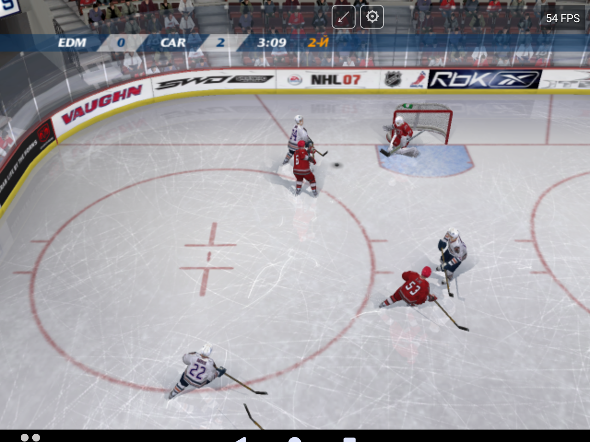
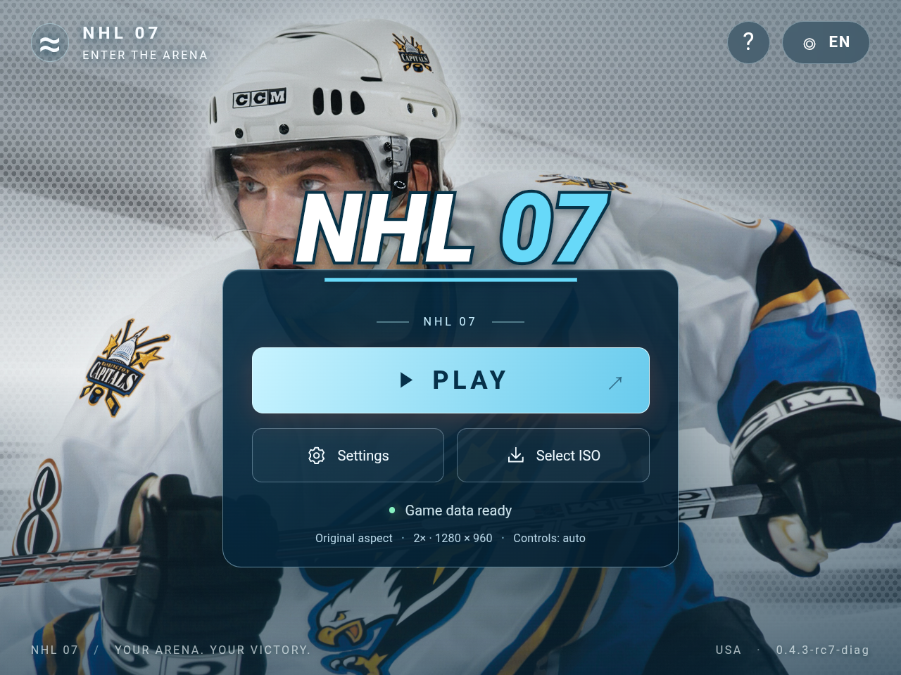
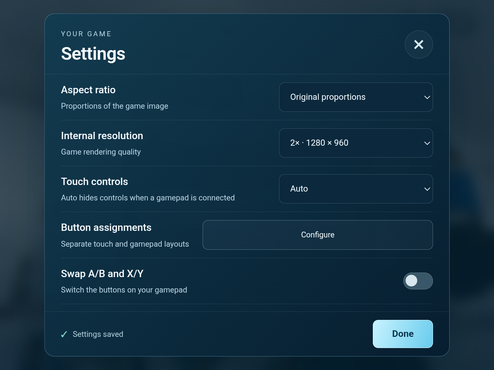
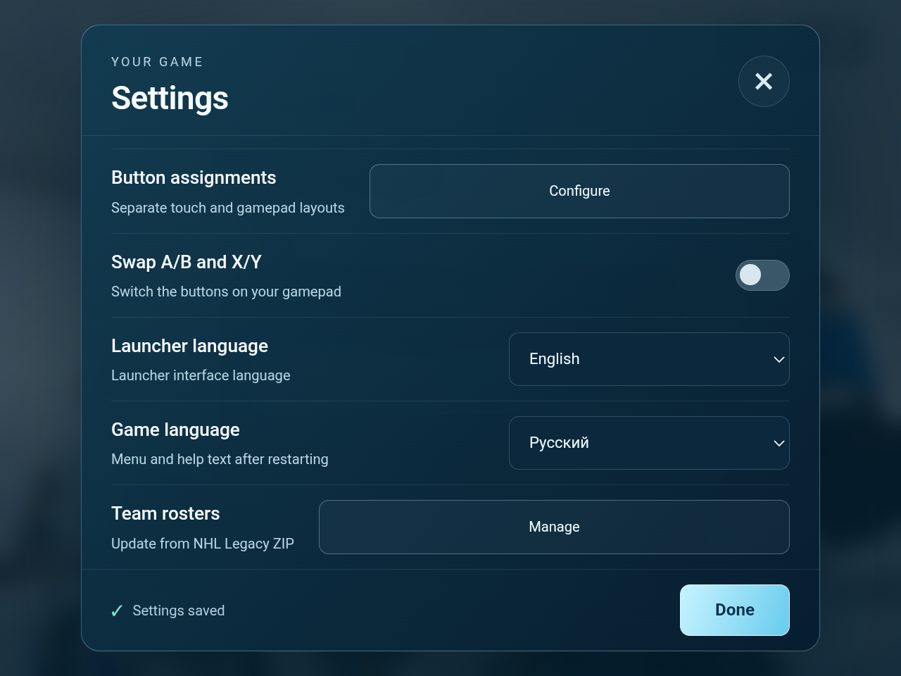

# NHL 07 for Android

Native ARM64 Android port of the original Xbox **NHL 07 (USA)**, developed and tested primarily on **Anbernic RG477M / Mali**. This is an experimental community port, unaffiliated with EA, the NHL or Microsoft.

[Download 0.4.3](https://github.com/Wannamingo/NHL07-Android/releases/tag/v0.4.3) · [Installation](docs/INSTALLATION.txt) · [Roster updates / Обновление составов](docs/ROSTERS.txt) · [Third-party notices](THIRD-PARTY-NOTICES.txt)

## Features

- Native recompiled game code with a system OpenGL ES renderer.
- Centered launcher with aspect ratio and internal resolution settings.
- Touch controls, controller mappings and button swapping.
- Separate English/Russian launcher and game-text settings. Commentary remains English.
- Roster manager that converts supported NHL Legacy Xbox 360 ROSTER ZIP updates and can restore the previous roster.
- FPS counter and a 60 FPS upper limit.
- Audio callback placement on suitable performance cores, restored after Android changes its affinity or the application resumes.

## Requirements and installation

Android 10 or later, an ARM64 processor, and OpenGL ES 3.0 are required. RG477M with Mali is the validated target; other devices are not comprehensively tested.

Install the APK from Releases, open the launcher, choose **Select ISO**, and select your own **NHL 07 (USA), original Xbox** disc image. The first import extracts the required data into the application's storage. Gameplay reads the imported files; it does not stream directly from the ISO. Keep the app's storage when updating so imported data and saves remain available.

This repository and the downloads do not include a complete game disc, XBE executable or VIV archives. The APK includes launcher artwork/icon and derived Russian localization assets. Game artwork, names and other EA/NHL material retain their respective rights and are not relicensed by the source-code notices.

## Updating team rosters / Обновление составов

Close the game and open **Settings → Team rosters → Manage → Update roster from ZIP**. Select a supported NHL Legacy EDGE Xbox 360 roster ZIP, wait for conversion and restart the game for a new match. Repeat with a newer ZIP whenever needed; the APK and original ISO do not need rebuilding or reimporting. Downloads are manual. The manager can enable the update, switch to original rosters, or restore the previous installed version.

Завершите игру: **Настройки → Составы команд → Управление → Обновить состав из ZIP**. Поддерживаются совместимые пакеты NHL Legacy EDGE для Xbox 360, включая проверенный `ROSTER 20261007011552.zip`. Конвертер переносит составы, игроков, поддерживаемые рейтинги и звенья; формы, логотипы, арены и озвучка остаются из NHL 07. Уже начатые сезоны не обновляются автоматически. [Подробная инструкция и требования к ZIP](docs/ROSTERS.txt).

## Release 0.4.3 validation

The audio and game core is byte-identical to the final candidate tested in an active five-minute RG477M match: **zero additional AudioFlinger underrun frames** over that measured window. The tester confirmed that sound remained clean during prolonged play. Version-only package promotion is recorded separately from direct gameplay testing.

The installed 0.4.3 package also passed three HOME/return cycles at the title/attract screen, preserving its process and restoring the game image. On-device platform checks separately exercised audio pause/resume and restoration of an externally reset callback affinity.

The screenshot's **54 FPS** is a momentary reading, not a measured average or a promise of stable 60 FPS. Performance varies by camera and scene. A prior controlled paused-scene buffer-cache comparison improved 26.7 to 29.8 FPS; that result is not an active-match benchmark of this release.

Some earlier developer cold starts stalled in the introductory video queue; the latest tester launch and release smoke test passed. The diagnostic remains in the core because the earlier stall's cause has not been established. Whole seasons, every mode and save-load compatibility have not been comprehensively verified. This is a playable experimental release rather than a claim that every game scenario is complete.

## Launcher screenshots

These unedited screenshots were supplied by the tester from candidate 0.4.3-rc7-diag. Release 0.4.3 uses the same native core, Java code, fonts and game resources; the displayed version has changed.

## Source and licenses

Corresponding source and build instructions are included with Releases and in this repository. See `BUILDING.txt` and `THIRD-PARTY-NOTICES.txt`; individual dependency licenses remain in their source directories. Original game data must be supplied by the user.
